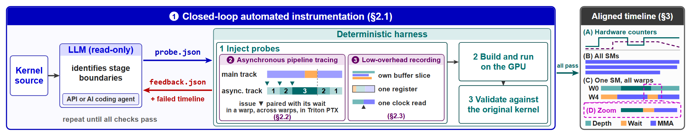

# WeaveProfiler

简体中文 | [English](README_EN.md)

> **让智能体与工程师看清 GPU 核内每一微秒——面向现代异步流水算子与智能体递归自我改进（RSI）的自动化核内剖析框架。**

**WeaveProfiler** 将**自动核内软件插桩**与**同次硬件利用率采样**对齐到时间线图中。框架支持以 **`Skill + MCP + Hook`** 直接嵌入 Claude Code、Qwen Code、OpenAI Codex CLI、Antigravity 等 AI 编程代理，也可通过 CLI 独立调用。支持 **CUDA C++、HIP C++、Triton 及 CuTeDSL**，插桩语义的识别由大模型完成，插桩动作与输出后处理由固定代码完成，尽可能确保可靠性和稳定性。

---

## 1. 为什么需要 WeaveProfiler

现代大模型算子（如 MegaMoE、FlashAttention-3、FlashMLA、GDN）普遍采用**持久化融合核（Megakernel）**：同一个 CTA 里的不同 Warp 分工负责搬运、矩阵计算与跨卡通信，靠多级**异步硬件流水线**（NVIDIA `cp.async` / TMA / `wgmma` / `tcgen05`、AMD `buffer_load` / `vmcnt` / `MFMA`）掩盖延迟。

现有剖析工具或直接让大模型手改源码插桩，主要卡在三个问题上：

1. **手改源码插桩容易出错且缺校验**：`nsys`、`rocprofv3` 只能看整核黑盒，分不清核内哪个 Warp 在干什么；让大模型直接改核函数打点，经常出现漏采部分 Warp、缓冲写满截断，或在热循环里打点过密拖慢算子。
2. **异步指令被当成同步指令测错**：源码级探针在异步指令刚发出时就记了结束，看不到底层真正的提交与等待边界（如 Triton 自动生成的 `commit_group` / `wait_group` 或 AMD `s_waitcnt vmcnt(N)`），导致测出来的搬运耗时比真实情况短几十倍。
3. **打点状态太重，挤爆寄存器或共享内存**：生产级融合核的寄存器和共享内存往往卡在硬件上限边缘；多占几个寄存器就会触发本地内存 `STL/LDL` 溢出，多占几 KB 共享内存就会把并发度从 `2 CTA/SM` 挤掉到 `1 CTA/SM`。

---

## 2. 核心思路与三项关键设计

> **核心思路**：整个剖析流程里，**只有“认出哪几行是哪个阶段”需要大模型读代码**；后面的打点注入、异步配对和真伪检查都可以用确定性的代码自动完成。



### 2.1 闭环自动插桩与四道门禁
- **只读认阶段 + 自动注入**：接入 AI 编程代理时通过 **`Skill + MCP + Hook`** 协同工作——`Skill` 约定剖析流程，生命周期 `Hook`（`PreToolUse` / `PostToolUse` / `Stop`）在工具调用前后拦截未封签的源码修改与探针残留，独立 `MCP` 服务对外提供剖析工具。大模型仅以只读方式分析源码、输出各 Warp 角色和阶段起止行号（`probe.json`），不碰核函数计算代码；随后由 `MCP` 背后的固定代码在工作区外的隔离副本里自动完成插桩与验证（对 Triton 算子亦支持在 **NVIDIA PTX 与 AMD AMDGCN 汇编层**做异步打点）。
- **四道硬门禁**：① **汇编顺序与溢出检查**（主干指令顺序不变，零新增寄存器溢出 `Δspill ≤ 0 B`，occupancy 无变化）；② **数值检查**（与原核输出一致）；③ **完整性检查**（起止成对、零丢包、100% 物理 Warp/wave 覆盖）；④ **双向开销检查**（稳态中位耗时变化在 `±10%` 以内）。
- **工作区外防篡改**：校验与封签在工作区外独立完成，配合 Hook 防止智能体修改门限或残留探针代码。

### 2.2 异步流水线追踪（单 Warp 与跨 Warp）
- **单 Warp 异步追踪**：按异步队列的提交与 `wait(N)` 边界配对，算出实时在途深度 `d`（同时在飞的请求数），并将真正卡在 `wait` 上的时间单独标为 **Exposed Wait**（区分等数据与等矩阵计算）。
- **跨 Warp 生产者–消费者配对**：在 1 个搬运 Warp 对多个计算 Warp 的环形流水线（如 FA3、FlashMLA）中，按 `(CTA, 槽位)` 将发射与首个完成等待的消费者配对，避免 1 对多重复计数或被慢消费者拉长耗时。

### 2.3 低开销记录与免改函数签名
- **每 Warp 独立显存切片 + 单寄存器状态**：每个 `(CTA, Warp/Wave)` 独享一段连续缓冲，只由 `lane 0` 顺序写出 16 字节记录，全程**无原子锁、无跨 Warp 同步**。默认模式 `WP_CTX_REG` 把槽位号与写指针压进 **1 个 32 位寄存器（`0 B` 共享内存）**，在 `setmaxnreg` 核上自动提前到缩减寄存器前初始化；极端零余量场景可选 `16 B` 共享内存回退（`WP_CTX_SMEM`）。
- **周期表校准 + 免改签名传参**：循环内读低开销周期计数器（`%clock64` / `s_memtime`），首尾用全卡纳秒墙钟校准，相邻阶段交界合并为一次读表；多头文件 C++ 算子通过全局设备符号传参，不用改任何 `__global__` / `__device__` 函数签名。

### 实现细节：跨架构硬件曲线真机标定（拒绝规格表静态分母失真）
不同 GPU 的底层计数器口径差异极大，直接套用工具默认百分比或规格表标称算力常会导致严重误判（把已跑满的核看成只用了一半，或反过来溢出 `100%`）。WeaveProfiler 通过**纯计算微基准 + 带访存满载算子**真机对标，按物理根因逐卡校准 Panel (A) 硬件曲线：
- **NVIDIA H20（`sm_90a`）—— 核心宽度裁剪 `×4.0` 校准**：`nsys` 的 `Tensor Active` 默认按完整 GH100 核心管线宽度归一，导致 H20 硬件打满时原始读数封顶在 `25%`；框架自动识别 H20 并执行 `×4.0` 还原。
- **AMD Instinct MI308X（`gfx942`, 80 CUs）—— 动态主频周期占空比校准（摒弃 `398.7T` 静态分母陷阱）**：
  - 未限频 CDNA3 理论峰值（`1.85 GHz`）为 `606.2 TFLOPS`，而 MI308X 规格表标称 FP8 峰值为 `398.7 TFLOPS`——**两者都不能作为固定分母**：真机（`80×512 = 1 CTA/CU`，零寄存器溢出）实测中，纯 `MFMA` 核（零访存）稳态达 **`461.3+ TFLOPS`**（挂载 `rocprof-sys` 仍达 `451.0 TFLOPS`，管线占空比 **`97.6%–99.5%`**），带 HBM3 访存与分块缩放的 AGPR 稠密 FP8 GEMM（`8192×8192×4096`）稳态实测达 **`443.4 TFLOPS`**（`SQ_VALU_MFMA_BUSY_CYCLES` 精确记满 `2MNK / 1024` 拍，误差 `0.000%`）。这证明 MI308X 硬件不存在 `398.7T` 硬算力墙；若按 `398.7T` 归一，真实算子会溢出至 **`111.2% > 100%`**（而早期 `torch._scaled_mm` 跑 `376.7 TFLOPS` 时硬件读出 `~81.7%`，正是 `376.7 / 461.3 = 81.7%` 的真实管线利用率）。
  - **统一精确公式**：不论 `rocprof-sys` 逐核聚合还是 `device_counting_service` 核内周期采样，一律采用 **`100 × ΔSQ_VALU_MFMA_BUSY_CYCLES / (80 × ΔGRBM_GUI_ACTIVE)`**（`scale = 1.0`）。因为 `ΔGRBM_GUI_ACTIVE / 4` 直接记录每颗 XCC 在当前动态主频（实测 `~1.38–1.42 GHz`，实时管线上限 `451.5–465.3 TFLOPS`）下流逝的真实着色器周期，动态降频在分母中天然抵消，读数严格落在 `[0, 100]%`（详见 [amd_mi308x.md](docs/amd_mi308x.md)）。
- **全双工互联独立成线与诚实缺省**：`NVLink TX / RX` 与 `xGMI TX / RX` 为独立全双工物理链路，严格分线绘制、绝不相加合并；GPU 直发绕过主机网卡计数器的跨机 RDMA 流量显式注明原因，绝不画假零线。

---

## 3. 四联软硬对齐图读法

WeaveProfiler 默认直出一张高分辨率四联 PNG，输出文件名自动包含模型名、算子名、尺寸与日期时间（`<model>_<op>_<shape>_<YYYYMMDD_HHMMSS>.png`，例如 `qwen3.5-397b_attn_bs5_seql4096_20261126_123000.png`），工程师和多模态大模型都能直接看，不用开几百 MB 的 Perfetto。前 3 栏共用同一微秒（`µs`）横轴，事件密集时自动展开第 4 栏放大图：

- **(A) 同次硬件利用率曲线**：同次运行采集的整卡计算利用率（Tensor / Matrix Core）、HBM 读写总带宽、独立全双工互联（`NVLink TX` 与 `NVLink RX` 分开画；AMD 为 `xGMI`）及活跃 SM/CU 占比；缺真实硬件曲线时直接报错拒画。
- **(B) 全卡 SM / CU 瀑布图**：纵轴列出全卡所有物理核心（如 H20 78 SMs、B300 148 SMs、MI308X 80 CUs），一眼看清波次切换、负载不均与长尾拖慢。
- **(C) 单 SM / CU 逐 Warp / Wave 时间线**：每个 Warp 拆成上下两层——**上层主轨**画计算阶段、亮黄斜纹 `Exposed Wait` 与写回；**下层异步副轨**画 `MEM`（绿）和 `MMA`（蓝）的发射针 `▼` 与 5 档颜色深浅的实时在途深度 `d`。
- **(D) 单 CTA 微距放大**：自动挑出 `Exposed Wait` 占比最高的完整 CTA（在 A–C 栏用洋红虚线框标出），看清预取爬坡、稳态重叠、等待气泡和收尾排空。


> **NVIDIA H20（`sm_90a`）`4096×4096×2048` Triton `num_stages=5` GEMM**：零 Python K-loop 修改，PTX 自动提取 `cp.async`（峰值在途深度 **`d = 8`**，清晰可见 `1→8` 爬坡与 `8→6→4→2→0` 排空）与 `wgmma`（**`d = 2`**）双异步轨及逐拍 `Exposed Wait`；稳态开销 **`+5.46%`**，`max_diff = 0.0`，同次 200 kHz `nsys` 13 个波次脉动与尾波掉谷微秒级对齐。

---

## 4. 跨架构四联图实测与“在途深度 `d` + `Exposed Wait` → 真机加速”案例

### 4.1 由「在途深度 `d` + `Exposed Wait`」直接导出真机加速汇总

WeaveProfiler 输出的 `(在途深度 d, Exposed Wait %)` 直接给出可执行的微架构调优判据——区分“**在途深度不足导致访存暴露**（应加深流水）”、“**在途已饱但计算同步分裂**（应融合 `wgmma` 等待而非盲目扩级）”与“**过度流水跨过寄存器/SMEM 驻留断崖**（应适度收拢级数换回高并发或扩大分块）”：

| 硬件平台 | 真实算子与规模 | 优化前 `(d, Exposed Wait)` | WeaveProfiler 诊断与微架构改动 | 优化后 `(d, Exposed Wait)` | 真机端到端加速（`max_diff=0`） |
| --- | --- | :---: | --- | :---: | :---: |
| **8×NVIDIA H20** (`sm_90a`) | DeepGEMM MegaMoE（Qwen3.5-397B, `EP=8, S=1024`） | 分核空等 `65 µs` + 同步 `Scatter` 阻塞 | 持久化动态队列单核融合 + `Scatter` 异步卸载至闲置 `Disp` Warp | 跨卡通信与 FP8 Tensor Core 重叠（利用率 `27.9% → 41.8%`） | `613.2 → 416.4 µs`（**`1.47×`**） |
| **NVIDIA H20** (`sm_90a`) | 上游 `vLLM fused_moe`（DeepSeek-V3 `M=128, E=256, H=7168, I=2048`） | `s=3` 默认：`steady d=2.3 (max 4)`，**`Wait = 33.6%`** | HBM 延迟未掩盖且 SMEM 仍有余量 → 提升流水级至 `num_stages=5` | `steady d=6.3 (max 8)`，**`Wait = 5.0%`**（降 `6.8×`） | `10,242.5 → 8,724.5 µs`（**`1.17×`** vs 默认 / **`1.29×`** vs `s=1`） |
| **NVIDIA H20** (`sm_90a`) | 上游 `vLLM FLA FlashKDA`（`chunk_fwd_h`, `T=4096`） | `s=2` 默认：`max d=5`，**`Wait = 27.5%`**（4 处分裂 `wgmma` wait） | 盲扩 `s=3`（`d=10`）跨过 `133 KB` SMEM 断崖退化至 `0.59×`；改用 `K=128` 融合 `RS-WGMMA`（`wgmma_waits: 4→2`） | 保留 `2 CTAs/SM`（`73.7 KB` SMEM），消除冗余同步 | `286.2 → 265.3 µs`（**`1.08×`**） |
| **NVIDIA B300** (`sm_103a`) | Blackwell Gather-GEMM（`4096×4096×2048` & `8192×8192×4096`） | `s=2`：`steady d=1.9 (max 2)`，**`Wait = 37.4% / 53.4%`** | 增至 `s=3` 掩盖 Gather 延迟（盲加至 `s=4` `131 KB` SMEM 掉至 `0.72×`） | `steady d=2.5 (max 4)`，**`Wait = 4.6% / 16.6%`**（降 `8.1×`） | `102.7 → 80.9 µs`（**`1.27×`**，较 `s=1` **`1.63×`**；8K 达 **`1,071.7 TFLOPS`**） |
| **AMD MI308X** (`gfx942`) | CDNA3 Async VMEM + MFMA GEMM（`4096×4096×2688`） | `s=1` 同步：`d=0`（阻塞等待 `vmcnt(0)`） | 构建 `global_load_dwordx4` + `s_waitcnt vmcnt(8)` 4 级异步寄存器–LDS 流水 | `steady d=2.1 (max 3)`，**`Wait = 1.7%`** | `1,572.9 → 810.0 µs`（**`1.94×`**，`111.3 TFLOPS`） |
| **2×8 AMD MI308X** (`gfx942`) | 跨机 EP16 MegaMoE（Qwen3.8-Max, `S=16384, E=512, K=10`） | 开场双段串行通信 + `GEMM1→GEMM2` 零重叠 | 单次开场融合 + 跨机 Top-K 去重预归约 + 3 组 `GEMM1↔GEMM2` 交错 + `1 CTA/CU (80×512)` 局部 Wave 同步 `4+4` 分波 | 全双工 `xGMI RX/TX` 与 `MFMA` 重叠（整卡管线 **`62.2%`** / 计算池 **`73.7%`**，`280.6T`） | `17,204.0 → 6,981.1 µs`（**`2.46×`** vs RCCL+AITER） |
| **RTX 3050** (`sm_86`) | Ampere CUDA C++ `cp.async` + WMMA GEMM（`2048×2048×1280`） | `6-stage (64×128)`：`steady d=4.0 (max 5)`，**`Wait = 19.8%`** | 在途深度冗余但小分块访存算术强度不足 → 收拢为 `3-stage (128×128)` 扩大分块复用 | `steady d=1.1 (max 2)`，**`Wait = 16.6%`**，MMA 占比升至 `79.7%` | `1,170.2 → 1,005.6 µs`（**`1.16×`**，达 `88.2%` cuBLAS） |

### 4.2 8×H20 生产级 DeepGEMM MegaMoE 优化（`1.47×` 加速）

在 8×H20 NVLink 节点上剖析 **Qwen3.5-397B DeepGEMM MegaMoE**（`EP=8, S=1024, E=512`），对齐图直接暴露分核启动间隙（`~65 µs`）与 `GEMM2` 同步 `Scatter` 阻塞而 `Disp` Warp 空转；融合为动态队列持久化单核并异步卸载 `Scatter` 后实现 **`1.47×`** 端到端加速（详见 [h20_megamoe_optimization.md](docs/case_studies/h20_megamoe_optimization.md)）：


### 4.3 AMD Instinct MI308X（`gfx942`, 80 CUs）4 级异步 VMEM（`vmcnt` FIFO, `d=3`）+ MFMA 四联图

在 AMD CDNA3 架构上，向量全局访存（`global_load_dwordx4` / `buffer_load_dwordx4`）天然异步发射并由硬件 `vmcnt` 计数器按 FIFO 顺序追踪完成，而 `v_mfma_*` 矩阵指令可与在途访存深度重叠。WeaveProfiler 同时支持 **HIP C++ 显式异步宏**（`WP_VMEM_COMMIT` / `WP_VMEM_WAIT`）与 **ROCm Triton AMDGCN 自动异步 Pass**（`triton_amdgcn_async.py`），下图实测自 **MI308X（80 CUs）4 级异步流水 GEMM**：稳态开销 **`+5.23%`**（`810.4 → 852.8 µs`），**`max_diff = 0.0`**，`0 B` spill，同次 `rocprof-sys` 软硬边界差 **`0.37%`**；Panel (C)/(D) 清晰呈现全部 4 条 `wave64` 的 `vmcnt` 异步发射针 `▼`、在途深度爬坡（`steady d = 2.1, max 3`）、`Exposed Wait (1.8%)` 及末尾 `3→2→1→0` 排空阶梯：


### 4.4 NVIDIA H20 开源算子库零签名修改四联图实测

无需修改开源库任何函数签名与调用链，全部通过四项检查（`max_diff = 0.0`、零溢出、100% 物理 Warp 覆盖）：

- **FlashInfer 0.6.8 Hopper FA3**（跨 3 头文件 CUDA C++，`B=5, H=16, S=4096, D=128`，12/12 Warps）：稳态开销 **`+0.15%`**（`2,618 → 2,622 µs`），软硬边界差 `0.08%`，跨 Warp 1-to-8 扫描线精确还原全 CTA TMA 峰值在途深度 `max_d_tma = 4`（2 K + 2 V）及计算组 `Softmax` 与异步 `WGMMA (d=1/2)` 双行真重叠。
- **FlashInfer 0.6.8 Hopper FlashMLA**（`mla_hopper.cuh`，`B=64, H=128, KV=2048`，8/8 Warps）：稳态开销 **`+9.96%`**，`0 B` spill，软硬边界差 `0.49%`，同图展示 `WG0` 的 `cp.async (d=1/2)` + `kOScaleReady` 等待与 `WG1` 的 `Softmax / WGMMA` 重叠。
- **vLLM FLA FlashKDA**（Triton 3.6 PTX 自动双异步，`B=1, T=4096, H=64, D=128`，4/4 Warps）：零 Python K-loop 修改，稳态开销 **`+8.14%`**，`0 B` spill，软硬边界差 `0.39%`，同时揭示 5 级 `cp.async` 在途绿带、`WGMMA` 副轨与逐块 `Exposed Wait`。


### 4.5 桌面级 Ampere（RTX 3050 `sm_86`）深流水 `cp.async` 与 Windows WDDM 抢占诊断

除数据中心加速器外，仓库同样支持本地 Ampere 桌面/移动 GPU 实测与排障：
- **6-Stage `cp.async` + WMMA GEMM（`2048×2048×1280`）**：经 Scheme A 首尾保留 + 稳态外提粗化后稳态开销仅 **`+0.70%`**（`1,178.6 → 1,186.8 µs`，`0 B` spill，`max_diff = 0.0`），Panel (D) 完整还原 `0→1→2→3→4→5` 异步预取爬坡与 `5→4→3→2→1→0` 排空阶梯。
- **Windows WDDM 桌面抢占排障（`8192³` Triton PTX 自动异步 GEMM，详见 [sm86_wddm_preemption.md](docs/case_studies/sm86_wddm_preemption.md)）**：精准捕获前 `0–25 ms` 冷启动 GDDR6 带宽爬升与 `t ≈ 30–33 ms` 系统图形抢占断崖。


### 4.6 双机 16×AMD Instinct MI308X（EP16）跨机 RDMA + 机内全双工 xGMI MegaMoE（`2.46×` 加速）

在双节点 16×MI308X（`2×8 GPUs`，机内全双工 xGMI + 跨机 RDMA）上剖析持久化单核 **MegaMoE（Qwen3.8-Max, `EP=16, S=16384, E=512, K=10`）**：
- **Panel (A) 动态主频周期占空比校准与全双工 xGMI 拆分**：MI308X 真机稠密 FP8 GEMM 稳态实测达 `443.4 TFLOPS`（动态主频 `~1.408 GHz` 管线上限 `461.3T` 的 `96.1%`，若除以规格表标称 `398.7T` 会溢出至 `111.2%`；详见 [amd_mi308x.md](docs/amd_mi308x.md)）。采用精确着色器周期占空比 `100 × ΔSQ_VALU_MFMA_BUSY_CYCLES / (80 × ΔGRBM_GUI_ACTIVE)`，整卡峰值达 **`62.2%`（`280.6 TFLOPS` @ `1.385 GHz`）**，其中 `540/640` 计算 Wave 池等效管线利用率达 **`73.7%`**；`xGMI RX (In)` 与 `xGMI TX (Out)` 独立成线，网卡侧不可采的跨机 RDMA 计数器显式注明、绝不补零。
- **Panel (B)–(D) 单 CTA/CU 融合流水**：全卡保持 `1 CTA/CU`（`80 CTAs × 512 Threads`），切分 4 条计算 Wave 与 4 条通信 Wave，通过开场跨机/机内分发融合、跨机 Top-K 去重预归约（单点 `+15.1%`）与 3 组 `GEMM1 ↔ GEMM2` 交错掩盖，让跨机 RDMA 与机内 xGMI 归约叠在 `MFMA` 满载区间之下，端到端延迟从 `17,204.0 µs` 降至 **`6,981.1 µs`（`2.46×` 加速，16 卡 FP64 校验通过）**：


---

## 5. 快速上手与支持矩阵

| 维度 | 支持范围 |
| --- | --- |
| **GPU 架构** | NVIDIA Hopper H20（`sm_90` / `sm_90a`）、Blackwell B300（`sm_100a` / `sm_103a`）、Ampere（`sm_86`）、AMD Instinct MI308X（`gfx942`） |
| **算子前端** | CUDA C++、HIP C++、Triton（NVIDIA PTX 自动双异步 & AMD AMDGCN 自动异步）、CuTeDSL |
| **接入方式** | 以 `Skill + MCP + Hook` 嵌入 AI 编程代理（`Claude Code`、`Qwen Code`、`OpenAI Codex CLI`、`Antigravity`），或通过 CLI 独立调用 |
| **运行依赖** | Python 3.10+、`nvcc` + `nsys`（NVIDIA）或 `hipcc` + `rocprof-sys`（AMD）、`numpy`、`matplotlib` |

### 接入 AI 编程代理（`Skill + MCP + Hook`）

两步挂载至目标算子仓库（`--protect` 自动保护原文件不被直接篡改，待首次基线剖析签发封签后解锁迭代优化）：

```bash
git clone https://github.com/ziyuhuang123/WeaveProfiler.git
python3 -B WeaveProfiler/run.py install-agent \
  --workspace /path/to/your_kernel_repo \
  --protect kernel.cu \
  --card h20   # 可选：h20 | b300 | mi308x | sm86
```

### CLI 直接调用

```bash
# 1) CLI 只读阶段识别 / 自动插桩剖析（不指定 -o 时自动输出 <model>_<op>_<shape>_<YYYYMMDD_HHMMSS>.png）
python3 -B WeaveProfiler/run.py identify kernel.cu -o probe.json --card h20
python3 -B WeaveProfiler/run.py profile  kernel.cu --card h20 \
  --workload-model qwen3.5-397b --op attn --bs 5 --seql 4096 \
  -- python3 bench.py

# 2) 环境与编译器自检
python3 -B WeaveProfiler/run.py doctor
```

### 沙箱批处理与离线单元测试

```bash
# 无交互智能体批处理（Linux 下可选自动启用 bubblewrap 只读隔离挂载）
python3 -B WeaveProfiler/run.py guard-exec --workspace /path/to/your_kernel_repo \
  -- codex exec "剖析该算子的暴露等待与跨 SM 负载不均并给出优化方案"

# 无需 GPU 的本地结构完整性与回归测试
python3 -B WeaveProfiler/tests/package_structure.py
python3 -B -m unittest \
  WeaveProfiler/tests/test_wp_megakernel.py \
  WeaveProfiler/tests/test_mcp_hook_installer.py \
  WeaveProfiler/tests/test_triton_amdgcn_async.py
```

**常用 MCP 工具与边界说明**：核心 MCP 工具包括 `weaveprof_megakernel_audit`（隔离注入 + 四项门禁 + 同次硬件对齐四联图 + HMAC 封签）、`weaveprof_status`、`weaveprof_analyze`、`weaveprof_compare_rounds` 与 `weaveprof_verify_seal`。已知边界：CUDA 单寄存器模式（`WP_CTX_REG`）单泳道容量上限为 `32,767` 条记录；AMD `rocprof-sys` 硬件 PM 计数器为按 dispatch 聚合粒度。完整记录器宏定义、编译开关与各平台细则请参阅 [SKILL.md](SKILL.md)。
